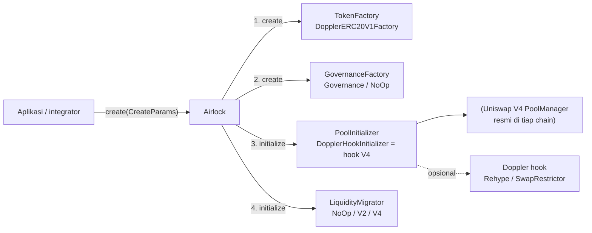

# 01 · Riset model acuan: Doppler, Bankr, Ascend

Semua klaim di dokumen ini dibaca dari sumber asli pada 4 Nov 2026. Rujukan berbentuk
`repo@commit:berkas:baris` supaya bisa dicek ulang.

| Sumber | Versi yang dibaca |
|---|---|
| Kontrak Doppler `github.com/whetstoneresearch/doppler` | `5754c7e` (26 Agu 2026, PR #548 "rehype-integrator") |
| SDK `@whetstone-research/doppler-sdk` (npm) + repo `whetstoneresearch/doppler-sdk` | 1.0.44 · `8d98f84` |
| Sumber dokumentasi docs.doppler.lol `whetstoneresearch/doppler-docs` | `0a8cd1c` (3 Nov 2026) |
| Uniswap `v4-core` | `bea7f6d` |
| PancakeSwap `infinity-core` | `3c5ef1b` |
| Source Ascend (vendor dari explorer testnet) `zynorr/ascendkit` | `28a5462` |
| Bankr: `MontyWorks/bankr-fee-walk` (mengutip docs.bankr.bot, 24 Sep 2026) dan `imDev2023/robinhood-chain-resources` (arsip on-chain 19 Sep 2026) | `ce0a483` |

> Akses: docs.doppler.lol, docs.bankr.bot, basescan dan RPC testnet Elysium diblokir dari lingkungan
> riset. Doppler dibaca dari repo sumbernya (termasuk sumber GitBook docs), Bankr dari dua repo pihak ketiga
> yang mengutip dokumen resmi dan data on-chain. Fakta Elysium testnet (instance Ascend aktif, modul CTO,
> launchpad vertikal) berasal dari riset lanjutan pengguna dan belum saya cek ulang.

---

## 1. Doppler: arsitektur protokol

Doppler adalah **protokol peluncuran bersama**: satu kontrak pusat (`Airlock`) yang menyusun empat modul yang
di-whitelist owner. Aplikasi seperti Bankr, Zora, dan Paragraph hanyalah *integrator* di atasnya.

| Modul | Kontrak | Tanggung jawab |
|---|---|---|
| Pusat | `Airlock` (`src/Airlock.sol`) | Validasi modul (`getModuleState`), panggil 4 modul berurutan, simpan `AssetData`, akuntansi fee protokol & integrator saat migrasi |
| Token | `DopplerERC20V1Factory` → clone `DopplerERC20V1` | Deploy token (CREATE2), mint supply, vesting di dalam token, batas saldo opsional |
| Governance | `GovernanceFactory` / `NoOpGovernanceFactory` | Governor + timelock, atau tanpa governance (Bankr: `0x…dead`) |
| Pool | `DopplerHookInitializer` (multicurve), `UniswapV4Initializer`, `LockableUniswapV3Initializer` | Buat pool di PoolManager, tanam likuiditas bertingkat, kunci posisi, kelola fee beneficiary |
| Migrasi | `NoOpMigrator`, `UniswapV2MigratorSplit`, `DopplerHookMigrator` | Pindah likuiditas setelah lelang. Rekomendasi resmi docs: **tidak migrasi** (`noOp`) |
| Ekstensi | `RehypeDopplerHookInitializer`, `SwapRestrictorDopplerHook` | Jadwal fee menurun, buyback, porsi integrator dari fee hook |

### 1.1 Field integrator: diisi sendiri, tidak diverifikasi

* `Airlock.create` menyimpan `integrator: createData.integrator == address(0) ? owner() : createData.integrator`
  (`doppler@5754c7e:src/Airlock.sol:182`). Tidak ada hubungan dengan `msg.sender`, tidak ada registry, tidak ada tanda tangan.
* Event `Create(asset, numeraire, initializer, poolOrHook)` (`Airlock.sol:91,185`) **tidak mencatat integrator,
  creator, maupun pemanggil**. Integrator hanya bisa dibaca lewat `getAssetData(asset)`.
* SDK: `withIntegrator(address?)` menerima alamat apa pun (`doppler-sdk@8d98f84:src/evm/builders/MulticurveBuilder.ts:705`).
* Modul Rehype punya integrator **kedua** yang juga dari calldata: hanya dicek `!= address(0)` dan porsi ≤ 75%
  (`RehypeDopplerHookInitializer.sol:1140-1151`, `RehypeTypes.sol:117`).

**Akibatnya:** siapa pun bisa menulis alamat Bankr sebagai integrator. Ini yang memungkinkan 19 token berlabel
Bankr palsu (temuan pengguna). Label "integrator = Bankr" di indexer tidak membuktikan token diluncurkan oleh aplikasi Bankr.

### 1.2 Bagaimana integrator dibayar

| Jalur | Mekanisme | Rujukan |
|---|---|---|
| Lelang yang migrasi | Saat `migrate()`, fee trading pool awal dibagi: protokol = maks(5% fee, 0,1% proceeds), dibatasi 20% fee; **sisanya ke integrator** (`getIntegratorFees[integrator][token]`). Integrator menarik dengan `collectIntegratorFees` (cek `msg.sender`) | `Airlock.sol:237-254, 296-306` |
| Multicurve terkunci (jalur Bankr, tanpa migrasi) | Fee LP posisi terkunci dibagi ke **daftar beneficiary + shares (total 1e18)** yang diisi pemanggil `create`; airlock owner wajib ≥ 5%. Integrator dibayar hanya jika pemanggil memasukkannya ke daftar | `DopplerHookInitializer.sol:247`, `BeneficiaryData.sol:23`, `FeesManager.sol` |
| Rehype | Porsi integrator immutable per pool dari fee hook (≤ 75%), klaim oleh integrator, bisa auto-payout | `RehypeTypes.sol:117`, `RehypeDopplerHookInitializer.sol:219-234` |

Pelajaran: pembagian fee Doppler fleksibel tetapi **ditentukan sepenuhnya oleh pemanggil**, sehingga "porsi
integrator" hanya sejujur pihak yang mengisi parameter.

### 1.3 Vesting / alokasi di `DopplerERC20V1`

| Aturan | Nilai | Rujukan |
|---|---|---|
| Alokasi maks per alamat | 80% supply | `DopplerERC20V1.sol:60` |
| Alokasi total maks | 80% supply | `:63` |
| Durasi vesting | **`0` diperbolehkan**, atau ≥ 1 hari | `:66, :240` |
| Perhitungan | jika `t ≥ start + duration` maka seluruh alokasi cair | `:464` |
| Default SDK | `duration: 0`, `cliffDuration: 0` | `MulticurveBuilder.ts:486-487` |

**Akibatnya:** "vesting" dengan durasi 0 = **alokasi instan sampai 80% supply**, dan itu perilaku default SDK.
Ini cocok dengan kasus token Bankr palsu (dev menerima 14–50% supply seketika). Kebijakan Bankr (15% vesting 1 tahun,
cliff 30 hari) hanyalah konvensi aplikasi Bankr, bukan aturan yang ditegakkan protokol.

### 1.4 Pool multicurve terkunci

* PoolKey: `fee` statis atau `DYNAMIC_FEE_FLAG` bila ada Doppler hook; hook = initializer itu sendiri
  (`DopplerHookInitializer.sol:_initialize`).
* Kurva = beberapa `Curve{tickLower, tickUpper, numPositions, shares}`, posisi satu sisi (`Multicurve.sol:28`).
* Jika daftar beneficiary diisi, status pool `Locked` (`:309`) dan **tidak ada jalur `exitLiquidity`**: LP terkunci permanen.
* Fee LP maks 10% (`MAX_LP_FEE = 100_000`, `:171`); Rehype mendukung jadwal `startFee → endFee` selama `durationSeconds` (anti-sniper).
* Kekuasaan owner Airlock: whitelist modul (`setModuleState`), mengaktifkan Doppler hook, menarik fee protokol.

### 1.5 Ketersediaan di Elysium

`Deployments.md` hanya memuat Ethereum (1), Monad (143), Robinhood (4663), Base (8453), Arbitrum One (42161),
dan Base Sepolia (84532). Tidak ada `99901`/`99801`/"elysium" di repo kontrak maupun SDK 1.0.44.

### 1.6 Lisensi

Kontrak Doppler berlisensi **BUSL-1.1** sampai 2027-12-31 (lalu GPL-2.0+). Kita **tidak menyalin kode Doppler**;
desain kita hanya mengambil konsep (pemisahan modul, integrator, multicurve terkunci) dan ditulis ulang.

---

## 2. Bankr: aplikasi di atas Doppler

| Aspek | Fakta | Sumber |
|---|---|---|
| Posisi | Integrator Doppler, bukan protokol sendiri; kontraknya = set Doppler + launcher tipis | robinhood-chain-resources `launchpads/bankr/README.md` |
| Alamat integrator (Robinhood 4663) | `0xf60633d02690e2a15a54ab919925f3d038df163e` | idem |
| Modul | `DopplerHookInitializer` `0x4e34…a544`, `NoOpMigrator` `0xba2f…5a0e`, governance `0x…dead` | idem |
| Skala | 90.404 aset di chain 4663 (58,8% dari semua peluncuran Doppler di sana, 19 Sep 2026) | idem |
| Supply standar | 100 miliar; 85% ke pool V4, 15% premint ke penerima fee, vesting 1 tahun + cliff 30 hari; penerima vesting tidak bisa dialihkan; vesting bisa dimatikan (100% ke pool) | bankr-fee-walk (mengutip docs.bankr.bot) |
| Fee | 1,75% total: creator 0,665% (95% dari fee pool 0,7%), LP terkunci 0,285%, protokol Bankr 0,475%, buyback BNKR 0,2375%, Doppler ±0,0875%. Jadwal fee dikunci saat launch | idem |
| Belum terverifikasi on-chain | Pembagian fee empat arah dan alamat launcher Bankr | idem ("Gaps") |

Pola yang kita tiru: **aplikasi tipis + protokol bersama**, tanpa migrasi, governance dimatikan, fee dikunci saat launch.
Pola yang kita perbaiki: identitas integrator yang bisa dipalsukan dan kebijakan supply yang hanya konvensi.

---

## 3. Ascend: mesin pool acuan (ringkas)

Detail lengkap ada di `docs/riset-launchpad-elysium.md` bagian 5.

* Factory = hook = pemilik posisi LP = kolektor fee, satu kontrak (`AscendLaunchpad.sol:252 launch`).
* **PancakeSwap Infinity**, bukan Uniswap V4; hook bitmap `0x0445` (beforeInitialize, beforeAddLiquidity,
  beforeSwap, beforeSwapReturnsDelta) di `LaunchpadKey.sol:32`.
* Likuiditas satu sisi **15 band** (puncak 200.000 tick di atas harga awal), quote USDC.
* Fee LP dinamis 90% → 1% selama 5 detik, lalu 1% selamanya (`AscendLaunchpad.sol:37-39, 897`).
* Fee dipanen dengan `collect()` lalu dibagi creator 50% / protokol 50% (`:84, :358`).
* `launch(LaunchParams)` memisahkan `creator` dari `msg.sender`, tetapi event `Launched` tidak mencatat pemanggil,
  dan referral 20% dicatat off-chain (temuan pengguna).

---

## 4. PoolManager: Uniswap V4 vs PancakeSwap Infinity

| | Uniswap V4 `PoolManager` | PancakeSwap Infinity `CLPoolManager` |
|---|---|---|
| Pause | **Tidak ada** fungsi pause | Owner / pausable role bisa pause `swap` dan `donate` (`CLPoolManager.sol:165, 218`) |
| Protocol fee maks | 1000 pips = 0,1% (`v4-core:ProtocolFeeLibrary.sol:8`) | 4000 pips = 0,4% (`infinity-core:ProtocolFeeLibrary.sol:10`) |
| Wewenang owner lain | Tunjuk `protocolFeeController` | `registerApp` di Vault, pause, fee controller |
| Izin hook | Bit di alamat hook (immutable, perlu *mining* CREATE2) | Bitmap di `PoolKey.parameters` |
| Ekosistem tooling | Doppler, Kleos, BOXA, KyberSwap/0x (aggregator umum) | Ascend |
| Lisensi | BUSL-1.1 hingga 2027-06-15 (non-produksi boleh; produksi butuh *Additional Use Grant*) | GPL-2.0-or-later |
| Status di Elysium | Mainnet: 11 PoolManager fork milik launchpad (2.581 pool); Uniswap resmi masih "Announced" | Mainnet: 0 pool; testnet: dipakai Ascend |

Keputusan dan alasannya ada di `02-desain-arsitektur.md` §5.
