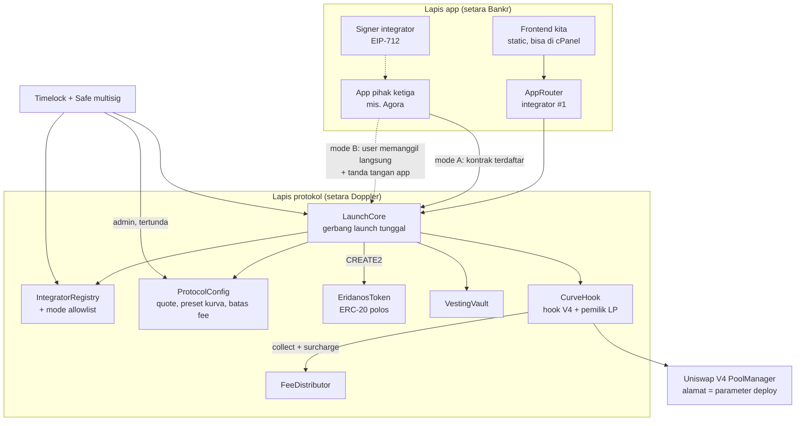
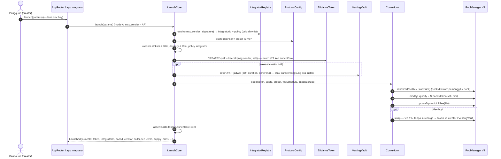
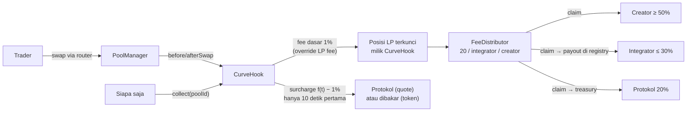

# 02 · Desain arsitektur: protokol peluncuran dua lapis di Elysium

Status: **revisi 2, keputusan pemilik proyek sudah dimasukkan (4 Nov 2026)**. Belum ada kode kontrak.
Target pertama: **Elysium testnet (99801)**.
Nama: protokol **Eridanos** (lapis protokol), app **Hypelys** (integrator #1). Ditetapkan 4 Nov 2026.

Dasar riset: `01-riset-model-acuan.md` (Doppler, Bankr, Ascend dari sumber asli) dan
`../riset-launchpad-elysium.md` (launchpad yang sudah ada di Elysium).

---

## 0. Keputusan yang sudah ditetapkan

| # | Topik | Keputusan | Alasan pemilik proyek |
|---|---|---|---|
| D1 | Mesin pool | Uniswap V4. Di testnet memakai PoolManager sendiri. **Alamat PoolManager = parameter deploy (immutable), tidak di-hardcode**, agar di mainnet bisa memakai deployment resmi Uniswap V4 bila Uniswap masuk Elysium. Tidak menumpang PoolManager launchpad lain | Mainnet Elysium sudah punya 2.674 pool V4 dan 0 pool Infinity, jadi aggregator dan bot sudah punya adaptor V4. Owner PoolManager milik pihak lain bisa mengatur protocol fee di pool kita |
| D2 | Bagi hasil fee | Protokol **tetap 20%** di semua kasus. Tanpa integrator: 20 / 0 / 80. Dengan integrator: integrator mengambil dari porsi creator, maks 30% (batas kontrak): 20 / ≤ 30 / ≥ 50. Nilai integrator tercatat on-chain per peluncuran | Bila tanpa integrator protokol mendapat 50% sementara pendaftaran integrator bebas, setiap creator akan mendaftarkan dirinya sendiri; angka 50/0/50 tidak akan terpakai dan menyesatkan |
| D3 | Fee anti-sniper | 90% → 1% dalam 10 detik. (a) Dihitung dengan `block.timestamp`, bukan `block.number`. (b) **Kelebihan di atas 1% masuk 100% ke protokol atau dibakar**, tidak dibagi ke creator/integrator. (c) Dev buy di transaksi peluncuran bebas fee anti-sniper, dibatasi persentase supply | (b) Kalau dibagi, creator bisa membeli tokennya sendiri di detik pertama dan mendapat kembali sebagian fee-nya, sehingga anti-sniper tidak berlaku baginya |
| D4 | Kebijakan supply | Alokasi creator maks **20%**; cliff minimum **0 hari**; vesting minimum **0 hari** (**alokasi instan diizinkan**); dev buy maks **10%** | Dikonfirmasi pemilik proyek saat ditanya tentang pertentangan dengan "tanpa alokasi instan" (lihat §4.2) |
| D5 | Quote | HYPE native dan USDC | — |
| D6 | Integrator | Pendaftaran bebas di testnet. Identitas = `msg.sender` terdaftar di registry (bukan field yang diisi sendiri), **mode B tanda tangan EIP-712 tetap didukung**, alamat pembayaran disimpan di registry, **mode allowlist** yang bisa dinyalakan owner untuk mainnet. Kebijakan alokasi integrator dibatasi kontrak protokol | — |

---

## 1. Masalah yang diselesaikan

| Masalah di ekosistem sekarang | Bukti | Jawaban desain ini |
|---|---|---|
| Tidak ada protokol peluncuran bersama di Elysium; tiap launchpad vertikal (hook terikat ke launcher sendiri, tanpa field integrator, tanpa bagi hasil untuk app) | Kleos, BOXA, ElysPump, Eleos, Elyxa; Doppler tidak ada di 99901/99801 | Satu kontrak launch terbuka (lapis protokol) yang bisa dipakai banyak app |
| App front-end (Agora) tidak tercatat di chain dan tidak dapat apa pun | Agora memanggil launcher pihak lain langsung | Integrator tercatat di event dan dibayar otomatis dari fee swap |
| Label integrator bisa dipalsukan | Doppler: `integrator` diisi bebas (`Airlock.sol:182`), event tidak mencatatnya; 19 token "Bankr" palsu | Integrator = `msg.sender` terdaftar **atau** tanda tangan EIP-712 dari signer terdaftar; tidak ada field bebas |
| Alokasi dev tersembunyi dan tanpa batas wajar | Doppler: vesting durasi 0 sah, sampai 80% supply (`DopplerERC20V1.sol:60,240,464`), tidak terlihat di event pembuatan | Alokasi maks 20% dan dev buy maks 10% ditegakkan kontrak; **semua angka alokasi, cliff, vesting, dan dev buy tercatat di event peluncuran**, termasuk tanda "instan" |
| Referral/bagi hasil off-chain | Ascend: referral 20% dicatat off-chain; event `Launched` tanpa pemanggil | Porsi protokol/integrator/creator disimpan per pool, immutable, bisa dibaca siapa saja |

---

## 2. Gambaran dua lapis



Prinsip:
1. **Lapis protokol tidak tahu apa pun tentang app tertentu**; app kita hanya integrator #1 dengan hak yang sama seperti app lain.
2. **Semua yang memengaruhi uang pengguna dikunci saat launch** (snapshot), sehingga perubahan admin hanya berlaku untuk launch berikutnya.
3. **Tidak ada proxy/upgrade**; versi baru = deployment baru.
4. **Alamat eksternal penting (PoolManager, quote) adalah parameter deploy yang immutable**, bukan konstanta di kode.

---

## 3. Lapis protokol: identitas integrator

### 3.1 Registry

`IntegratorRegistry` menyimpan satu record per integrator:

| Field | Diubah oleh | Catatan |
|---|---|---|
| `id` (uint32, berurutan) | — | Identitas kanonik. UI wajib menampilkan id + alamat, bukan nama |
| `account` | integrator (2 langkah) | Alamat yang boleh memanggil `launch` dalam mode A |
| `signer` | integrator | Kunci untuk mode B; EOA atau kontrak (EIP-1271) |
| `payout` | integrator | Penerima fee integrator; **disimpan di registry**, berlaku untuk klaim berikutnya |
| `name`, `uri` | integrator | Tidak unik, hanya label |
| `policy` | integrator, **tertunda 24 jam**, hanya untuk launch berikutnya | `integratorBps` (0–3000) dan kebijakan alokasi; lihat §4 dan §6 |
| `verified` | Timelock | Lencana tampilan; tidak diperlukan untuk launch |
| `active` | integrator / Timelock | Integrator nonaktif tidak bisa dipakai untuk launch baru; pool lama tetap membayar |

**Mode allowlist** (`allowlistEnabled`, diatur Timelock):

| Mode | `register` | Launch dengan atribusi (A/B) | Launch tanpa integrator (C) |
|---|---|---|---|
| Mati (testnet) | Siapa saja | Integrator `active` mana pun | Boleh |
| Nyala (opsi mainnet) | Siapa saja, tetapi record baru berstatus *pending* | Hanya integrator yang di-allow oleh Timelock | Boleh |

Menyalakan allowlist tidak memengaruhi pool yang sudah ada maupun pembayaran ke integrator lama.

**Pelajaran vanity address:** kecocokan dilakukan pada `id`/alamat penuh, bukan akhiran alamat atau nama.
Indexer dan UI mengambil label dari registry, bukan dari metadata token.

### 3.2 Tiga mode atribusi

| Mode | Siapa memanggil `launch` | Bukti identitas | `integratorId` |
|---|---|---|---|
| **A · Caller** | Kontrak/akun milik integrator (mis. `AppRouter`, modul CTO) | `msg.sender == registry.account(id)` dan diizinkan | id tersebut |
| **B · Signed** | Pengguna langsung (front-end tanpa kontrak, mis. Agora) | Tanda tangan EIP-712 `LaunchIntent` dari `registry.signer(id)` | id tersebut |
| **C · None** | Siapa saja | — | `0`; split 20 / 0 / 80 |

`LaunchIntent` (EIP-712, domain `name = "Eridanos"`, `version = "1"`, `chainId`, `verifyingContract = IntegratorRegistry`).
Registry yang memverifikasi tanda tangan karena registry yang menyimpan signer dan nonce. Hanya core yang
diotorisasi Timelock yang boleh memakai nonce, sehingga pihak lain tidak bisa "membakar" nonce integrator:

```
LaunchIntent {
  uint32  integratorId;
  address core;          // LaunchCore yang boleh memakainya: tanda tangan terikat ke satu versi core
  address caller;        // harus == msg.sender: tanda tangan tidak bisa dipakai orang lain
  address creator;
  bytes32 paramsHash;    // hash LaunchParams tanpa tanda tangan
  uint256 nonce;         // sekali pakai per integrator
  uint64  deadline;
}
```

Tidak ada cara mengisi integrator lewat parameter bebas. Mode A dan B saling eksklusif dalam satu panggilan.

### 3.3 Event peluncuran

```
event Launched(
  uint256 indexed launchId,
  address indexed token,
  uint32  indexed integratorId,
  bytes32 poolId,
  address creator,
  address caller,            // msg.sender
  uint8   attribution,       // 0 none, 1 caller, 2 signed
  address quote,
  uint16  curvePresetId,
  FeeTerms feeTerms,         // jadwal fee, protocolBps = 2000, integratorBps, creatorBps (§5–6)
  SupplyTerms supplyTerms,   // pool, alokasi + cliff + durasi (+ flag instan), dev buy
  uint16  coreVersion
);
```

Dengan event ini, siapa pun bisa menghitung ulang pembagian, memastikan label app benar, dan melihat berapa
supply yang dipegang creator sejak detik pertama.

---

## 4. Kebijakan supply (ditegakkan kontrak)

### 4.1 Aturan

Supply tetap **1.000.000.000** per token (konstanta protokol). Token di-mint **sekali** di konstruktor
ke `LaunchCore`, lalu dibagi habis dalam transaksi yang sama.

| Tujuan | Aturan | Batas protokol (konstanta) |
|---|---|---|
| **Pool** (likuiditas satu sisi) | `supply − alokasi` | ≥ 80% |
| **Alokasi creator** (opsional) | `0%` atau `X%` | `X ≤ policy.maxAllocBps ≤ 2000` (20%) |
| Cliff | `cliff ≥ policy.minCliff` | minimum protokol **0 hari** |
| Vesting | `duration ≥ policy.minDuration`, `cliff ≤ duration`, linear setelah cliff | minimum protokol **0 hari** (instan diizinkan) |
| Alokasi instan (`duration = 0`) | Token langsung ke penerima di tx launch | Tetap terhitung dalam batas 20%; **ditandai `instant = true` di event** |
| Penerima alokasi | Maks 3 alamat, skema sama, **tidak bisa dialihkan** | Semua tercatat di event |
| **Dev buy** (opsional) | Dibeli lewat pool di tx launch, **bebas fee anti-sniper**, membayar fee dasar 1% | `≤ policy.maxDevBuyBps ≤ 1000` (10%) token keluar |
| Kunci dev buy (opsional per integrator) | Token hasil dev buy masuk `VestingVault` | Ditetapkan di policy |

`policy` integrator hanya boleh **sama atau lebih ketat** daripada batas protokol. Integrator yang ingin melindungi
penggunanya (misalnya app kita) bisa mewajibkan cliff/vesting minimum dan batas lebih kecil.

Semantik vesting (`VestingVault`): `vested(t) = 0` sebelum `start + cliff`; `total · (t − start) / duration` sampai
`start + duration`; lalu `total`. Cliff berada **di dalam** jendela vesting (seperti Bankr). `duration = 0` dibayar
langsung di dalam `createSchedule`, tetapi jadwalnya tetap tercatat on-chain.

Invarian yang diuji:
* Setelah `launch`, saldo token di `LaunchCore` = 0; `totalSupply = tokenDiPool + tokenDiVault + alokasiInstan`
  (dev buy keluar dari pool).
* `EridanosToken` tidak punya `owner`, `mint`, pajak transfer, blacklist, atau kunci transfer. Metadata immutable
  (syarat mirror bridge Elysium → HyperEVM).
* Tidak ada jalur lain untuk memindahkan token ke creator selain alokasi dan dev buy, keduanya dalam batas kontrak dan tercatat di event.

### 4.2 Konsekuensi keputusan D4 (dicatat apa adanya)

* Dengan batas maksimum, creator bisa memegang **hingga 30% supply sejak detik pertama**: 20% alokasi instan +
  10% dev buy tanpa fee anti-sniper. Pola ini sama dengan token Bankr palsu (14–50% instan); perbedaannya hanya
  ada **batas keras** dan **pengungkapan on-chain**, bukan larangan.
* Karena itu desain mengandalkan tiga hal:
  1. event `Launched` memuat persentase, cliff, durasi, dan flag instan;
  2. getter `supplyTerms(token)` bisa dibaca siapa saja;
  3. UI/indexer wajib menampilkan "alokasi creator X% (instan / vesting …)" di halaman token.
* Integrator bisa menutup celah ini untuk penggunanya lewat `policy` (mis. `minDuration` > 0).
* Untuk dibahas ulang sebelum mainnet: apakah batas protokol diperketat lagi.

---

## 5. Mesin pool model Ascend

### 5.1 Keputusan: Uniswap V4, alamat PoolManager sebagai parameter

| Pilihan | Untuk | Melawan |
|---|---|---|
| **Uniswap V4** (dipilih) | 2.674 pool V4 di mainnet Elysium vs 0 pool Infinity, sehingga aggregator dan bot sudah punya adaptor V4; tidak ada pause di core; owner hanya bisa menunjuk fee controller (≤ 0,1%); izin hook terkunci di alamat; artifact resmi di npm `@uniswap/v4-core@1.0.2` | BUSL-1.1 sampai 2027-06-15 untuk penggunaan produksi; alamat hook harus di-*mine* |
| PancakeSwap Infinity | GPL-2.0; model persis Ascend | Owner/pausable role bisa **membekukan swap semua pool**; fee protokol hingga 0,4%; tidak ada adaptor aggregator di Elysium |

**PoolManager tidak di-hardcode.** `CurveHook`, `LaunchCore`, dan `AppRouter` menerima `IPoolManager poolManager`
di konstruktor dan menyimpannya sebagai `immutable`. Alamat hook di-*mine* ulang untuk setiap deployment, karena
initcode memuat alamat PoolManager.

**Menumpang PoolManager launchpad lain ditolak**:
* Owner fork V4 milik Kleos/BOXA bisa mengatur protocol fee di pool kita, dan bytecode-nya tidak terverifikasi.
* `CLPoolManager` Infinity milik Ascend di testnet bisa di-pause owner-nya.

| Jaringan | PoolManager yang dipakai |
|---|---|
| Testnet 99801 | Deploy sendiri dari artifact kanonik (penggunaan non-produksi diizinkan BUSL). Setelah deploy: `protocolFeeController = 0`, owner dipindah ke Timelock |
| Mainnet (butuh persetujuan terpisah) | (1) Deployment resmi Uniswap V4 bila sudah ada di Elysium; atau (2) deploy sendiri setelah dapat *Additional Use Grant* / lewat 2027-06-15 |

### 5.2 PoolKey dan izin hook

```
PoolKey {
  currency0/1 : token + quote (HYPE native = address(0), atau USDC)  // diurutkan
  fee         : DYNAMIC_FEE_FLAG
  tickSpacing : 200
  hooks       : CurveHook
}
```

| Izin hook | Fungsi |
|---|---|
| `beforeInitialize` | Tolak pool dengan hook kita yang tidak dibuat oleh `CurveHook` sendiri |
| `beforeAddLiquidity` | Tolak semua penambahan likuiditas dari luar: pool tertutup |
| `beforeSwap` + `beforeSwapReturnsDelta` | Fee LP override = 1%; selama jendela anti-sniper, pungut *surcharge* pada swap exact-input |
| `afterSwap` + `afterSwapReturnsDelta` | Pungut *surcharge* pada swap exact-output (jumlah input baru diketahui setelah swap) |

V4 tidak memanggil hook bila pemanggilnya hook itu sendiri, sehingga `initialize`, penanaman likuiditas,
`collect`, dan dev buy oleh `CurveHook` lolos tanpa callback. Dev buy memakai fee LP dinamis yang **tersimpan**,
sehingga urutan di `seed` adalah: `initialize` → tanam band → `updateDynamicLPFee(1%)` → dev buy.
Hasilnya, dev buy membayar 1% dan bebas surcharge (D3c). Nilai tersimpan 1% juga yang dibaca aggregator saat
menghitung kuotasi.

### 5.3 Kurva bertingkat (likuiditas satu sisi)

* **Preset kurva** didaftarkan di `ProtocolConfig` per quote: `startTick` dan daftar band `{offsetLower, offsetUpper, bps}`.
* Validasi preset: band terurut dan tidak tumpang tindih, kelipatan `tickSpacing`, total `bps = 10.000`, dalam
  rentang tick yang sah, likuiditas per tick di bawah batas PoolManager.
* Integrator memilih preset dari daftar yang diizinkan; creator tidak bisa mengirim kurva bebas. Ini mencegah kurva
  jebakan seperti band pertama yang sangat tipis.
* Karena alokasi bisa sampai 20%, jumlah token di pool bervariasi (80–100% supply); setiap band menerima porsi
  `bps` dari jumlah yang benar-benar ditanam.
* Preset awal mengikuti pola Ascend; angka konkretnya ditetapkan di fase 3 dengan simulasi.

### 5.4 Fee anti-sniper: 90% → 1% dalam 10 detik

```
f(t) = 1% + (90% − 1%) · (10 − t) / 10    untuk 0 ≤ t < 10 detik
f(t) = 1%                                 untuk t ≥ 10 detik
t    = block.timestamp − launchedAt        // bukan block.number (di Orbit = nomor blok parent chain)
```

Fee dipecah menjadi dua bagian dengan tujuan berbeda:

| Bagian | Besar | Dipungut lewat | Tujuan |
|---|---|---|---|
| **Fee dasar** | 1% selamanya | Fee LP override di `beforeSwap` → menumpuk di posisi LP terkunci | Dibagi 20 / integrator / creator (§6) |
| **Surcharge anti-sniper** | `f(t) − 1%` selama 10 detik pertama, lalu 0 | *Return delta* hook pada mata uang input; diklaim hook sebagai ERC-6909 di PoolManager | **100% protokol** bila dalam quote; **dibakar** (dikirim ke `0x…dEaD`) bila dalam token. Tidak pernah ke creator atau integrator |

* Creator yang membeli tokennya sendiri lewat router di detik pertama membayar surcharge penuh ke protokol, jadi
  anti-sniper berlaku juga baginya (D3b). Satu-satunya pengecualian adalah dev buy di tx launch (D3c), yang dibatasi 10%.
* Rumus surcharge yang pasti (atas input bruto, dengan fee dasar dikenakan pada sisa) dikunci di fase 3 dan diuji
  agar total efektif = `f(t)` dengan toleransi pembulatan.
* Jadwal disimpan per pool saat launch dan **immutable**.
* Catatan Elysium: blok 100 ms tetapi `block.timestamp` beresolusi 1 detik, jadi fee turun per detik dan ±10 blok
  pertama berbagi fee 90%.

| Parameter | Batas protokol (konstanta) | Nilai yang dipakai |
|---|---|---|
| `startFee` | ≤ 90% | 90% |
| `decay` | 0–60 detik | 10 detik |
| `baseFee` | 0,3%–2% | 1% |

### 5.5 LP terkunci

* Semua posisi dimiliki `CurveHook` (salt 0). **Tidak ada fungsi yang memanggil `modifyLiquidity` dengan delta negatif.**
* `collect(poolId)` permissionless memanen fee dasar dengan `modifyLiquidity(…, 0)`, lalu meneruskannya ke `FeeDistributor`.
  Surcharge diteruskan terpisah (porsi protokol) atau dibakar.
* Invarian: likuiditas setiap band tidak pernah turun (diuji dengan fuzz/invariant).

### 5.6 Fase 2 (di luar cakupan awal)

* Flywheel bid ala Ascend: cadangan beli dengan batas EMA dan clip per jendela waktu.
* Fee dasar hanya dalam quote.
* Listing HyperCore setelah `ElysiumCoreWriter` tersedia.

---

## 6. Bagi hasil fee dasar (on-chain, bisa diaudit)

Fee dasar 1% terkumpul di posisi milik `CurveHook` dalam dua mata uang (token dan quote), lalu dipanen dengan
`collect`. `FeeDistributor` membaginya dengan porsi yang **di-snapshot saat launch**:

| Porsi | Nilai | Sumber | Batas |
|---|---|---|---|
| `protocolBps` | **2000 (20%) di semua kasus** | Konstanta kode | Tidak bisa diubah, tidak bisa dinegosiasikan |
| `integratorBps` | 0–3000 | `policy.integratorBps` integrator saat launch; **0 bila tanpa integrator** | Maks 3000 (konstanta) |
| `creatorBps` | `8000 − integratorBps` | Turunan | Selalu ≥ 5000 |

| Kasus | Protokol / integrator / creator |
|---|---|
| Tanpa integrator (mode C) | 20 / 0 / 80 |
| Integrator memakai porsi maksimum | 20 / 30 / 50 |
| Integrator memakai, mis., 10% | 20 / 10 / 70 |

* `integratorBps` yang dipakai tercatat di `Launched` dan di getter `feeTerms(poolId)`.
* Akuntansi: `owed[poolId][role][currency]`. Klaim:
  * creator: alamat peran creator saat ini (bisa dialihkan 2 langkah oleh creator; admin tidak bisa menimpa);
  * integrator: `payout` di registry saat klaim;
  * protokol: treasury di `ProtocolConfig`.
* Setiap `collect` meng-emit `FeesSplit(poolId, amount0, amount1, toProtocol, toIntegrator, toCreator)`;
  surcharge meng-emit `SurchargeCollected(poolId, currency, amount, burned)`.
* Pembulatan: sisa wei masuk ke creator agar total selalu tepat (diuji).
* Insentif mendaftarkan diri sebagai integrator hanya untuk mengambil porsi ekstra hilang, karena porsi integrator
  diambil dari creator, dan creator tanpa integrator sudah mendapat 80%.

---

## 7. Lapis app

### 7.1 App kita (integrator #1)

* **`AppRouter`**: kontrak tipis, terdaftar sebagai `account` integrator #1, alamat PoolManager immutable. Fungsi:
  * `launch(params)` meneruskan ke `LaunchCore` dengan `creator = msg.sender` dan menarik dana dev buy dari pengguna;
  * helper swap (beli/jual lewat PoolManager).
* Tanpa state uang, tanpa *arbitrary call*, tanpa owner yang bisa memindahkan dana pengguna.
* Frontend statis (menggantikan frontend MVP), indexer berbasis event `Launched` / `FeesSplit` / `SurchargeCollected` / `Swap`.
  Halaman token wajib menampilkan alokasi creator dan dev buy (§4.2).
* Policy integrator #1 (porsi integrator dan batas alokasi app kita) belum ditetapkan; lihat `03-rencana-kerja.md`.

### 7.2 Integrator pihak ketiga (mis. Agora)

Langkah onboarding:
1. `IntegratorRegistry.register(name, uri, account, signer, payout, policy)` (saat allowlist menyala: tunggu persetujuan Timelock).
2. Pilih mode:
   * **A**: deploy router sendiri; pengguna memanggil router.
   * **B**: backend menandatangani `LaunchIntent`; pengguna memanggil `LaunchCore` langsung.
3. Policy berlaku untuk launch yang dibuat setelah jeda 24 jam.
4. Klaim fee kapan saja ke `payout`.

Kami menyediakan SDK TypeScript kecil untuk membangun `LaunchParams` dan `LaunchIntent`, plus contoh integrasi.

---

## 8. Alur launch



Alur swap dan fee:



---

## 9. Daftar kontrak dan tanggung jawab

| # | Kontrak | Lapis | Tanggung jawab | Admin |
|---|---|---|---|---|
| 1 | `LaunchCore` | Protokol | Gerbang `launch`; resolusi integrator (A/B/C); validasi policy, preset, batas supply; deploy token; orkestrasi vault + hook; emit `Launched`; pause launch baru. PoolManager = parameter konstruktor | Timelock (pause: guardian) |
| 2 | `IntegratorRegistry` | Protokol | Daftar integrator, signer, payout, policy tertunda, nonce EIP-712, `verified`, **mode allowlist** | Integrator untuk record-nya; Timelock untuk `verified`/`active`/allowlist |
| 3 | `ProtocolConfig` | Protokol | Quote yang diizinkan, preset kurva, treasury | Timelock; perubahan hanya untuk launch berikutnya |
| 4 | `EridanosToken` | Protokol | ERC-20 polos, supply tetap, metadata immutable, tanpa owner | Tidak ada |
| 5 | `VestingVault` | Protokol | Simpan alokasi ber-vesting; cliff + linear; `release` oleh siapa saja ke penerima tetap | Tidak ada |
| 6 | `CurveHook` | Protokol | Hook V4; buat pool, tanam band, fee dasar + surcharge, blok likuiditas luar, `collect`; pemilik posisi LP. PoolManager = parameter konstruktor | Tidak ada (hanya `LaunchCore` yang boleh `seed`) |
| 7 | `FeeDistributor` | Protokol | Akuntansi `owed` per pool/peran; klaim; pengalihan peran creator; terima surcharge protokol | Tidak ada |
| 8 | `TimelockController` + Safe | Tata kelola | Pemilik admin; jeda wajib | Multisig |
| 9 | `PoolManager` (V4 kanonik) | Infrastruktur | AMM singleton | Testnet: owner → Timelock, fee controller = 0 |
| 10 | Router swap + `V4Quoter` | Infrastruktur | Swap & kuotasi (periphery resmi atau router minimal) | Tidak ada |
| 11 | `AppRouter` | App | Integrator #1: launch atas nama pengguna, helper swap | Tidak ada |
| 12 | Frontend, indexer, SDK | App | UI, data, integrasi pihak ketiga | — |

Kontrak MVP lama (`contracts/ElysiumLaunchpad.sol`, bonding curve → Uniswap V2) dipensiunkan dan disimpan sebagai referensi.

---

## 10. Keamanan dan tata kelola

### 10.1 Peran

| Peran | Pemegang | Bisa | Tidak bisa |
|---|---|---|---|
| Owner protokol | `TimelockController` (proposer: Safe multisig; jeda testnet 1 jam, mainnet 48 jam) | Ubah `ProtocolConfig` dalam batas konstanta; set `verified`/`active`; nyalakan/matikan allowlist dan setujui integrator; unpause | Menyentuh pool, fee yang sudah terkumpul, vesting, token yang sudah diluncurkan; mengubah porsi protokol 20% |
| Guardian | Safe multisig (tanpa jeda) | **Pause** `launch` dan pendaftaran integrator baru | Pause swap, `collect`, klaim, rilis vesting; unpause (harus lewat Timelock) |
| Integrator | Pemilik record | Ubah signer/payout (langsung), policy (tertunda 24 jam, hanya launch baru) | Mengubah pool yang sudah ada |
| Creator | Alamat peran creator | Klaim; alihkan peran (2 langkah) | Mengubah split, fee, kurva, vesting |

### 10.2 Yang tidak boleh bisa diubah setelah launch

Supply token; metadata token; PoolKey (termasuk hook, quote, PoolManager); preset kurva dan posisi LP; jadwal fee
(start, decay, base) dan aturan surcharge; split 20 / integrator / creator; `integratorId` pool; alokasi, penerima,
dan jadwal vesting; status LP terkunci.

### 10.3 Batas parameter (konstanta kode, bukan setelan)

`TOTAL_SUPPLY = 1e27` · `MAX_ALLOC_BPS = 2000` · `MIN_CLIFF = 0` · `MIN_VESTING = 0` · `MAX_ALLOC_RECIPIENTS = 3` ·
`MAX_DEVBUY_BPS = 1000` · `START_FEE = 90%` · `DECAY = 10 s` · `BASE_FEE = 1%` · `PROTOCOL_BPS = 2000` ·
`MAX_INTEGRATOR_BPS = 3000` · `TICK_SPACING = 200` · `POLICY_DELAY = 24 jam`.

Bukan konstanta: alamat `PoolManager` (parameter konstruktor immutable), quote dan preset kurva (`ProtocolConfig`, via Timelock).

### 10.4 Pengaman lain

* Tanpa proxy, tanpa `delegatecall` ke alamat dinamis, tanpa *arbitrary call*.
* Reentrancy guard transien (ArbOS di Elysium mendukung `TSTORE`).
* Quote hanya token standar dari whitelist; tidak mendukung token fee-on-transfer atau rebasing.
* Alamat token: `CREATE2` dengan salt `keccak(msg.sender, salt)`, supaya salt tidak bisa didahului orang lain.
* EIP-712 memakai domain `chainId` + `verifyingContract`, nonce sekali pakai, `deadline`, pengikatan `caller`,
  dan dukungan EIP-1271.
* Waktu hanya dari `block.timestamp`; `block.number` tidak dipakai di mana pun.
* Invarian yang diuji:
  * konservasi supply; LP tidak pernah berkurang;
  * total klaim ≤ total fee dasar; surcharge tidak pernah masuk ke creator/integrator;
  * porsi tidak berubah setelah launch; porsi protokol selalu 20%;
  * tidak ada token tersisa di `LaunchCore`.
* Audit eksternal wajib sebelum mainnet.

### 10.5 Risiko yang tetap ada

| Risiko | Mitigasi |
|---|---|
| Creator memegang hingga 30% supply sejak awal (alokasi instan 20% + dev buy 10%) | Batas keras kontrak, pengungkapan di event dan getter, tampilan wajib di UI, integrator bisa memperketat (§4.2) |
| Bila nanti memakai PoolManager resmi Uniswap: owner-nya bisa mengaktifkan fee protokol ≤ 0,1% | Diterima; tidak ada pause di V4 |
| Lisensi BUSL v4-core untuk produksi | Mainnet butuh keputusan terpisah (§5.1) |
| Spam pendaftaran integrator / nama tiruan | Nama tidak unik, `verified` via Timelock, UI menampilkan id, mode allowlist untuk mainnet |
| Sniper dalam detik pertama | Surcharge hingga 89% ke protokol/dibakar; dev buy dibatasi dan tercatat |
| Kunci signer integrator bocor | Integrator bisa rotasi signer; nonce & `deadline`; dampak terbatas pada atribusi launch baru |
| Granularitas `block.timestamp` 1 detik | Fee turun per detik; ±10 blok pertama berbagi fee 90% |
| Kompleksitas *return delta* hook (surcharge) | Diisolasi di dua fungsi, diuji untuk exact-input dan exact-output, kedua arah, kedua urutan mata uang |
