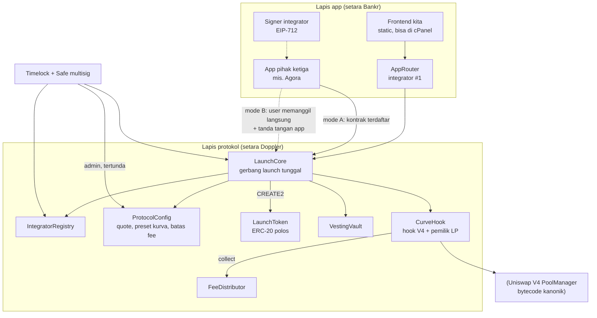
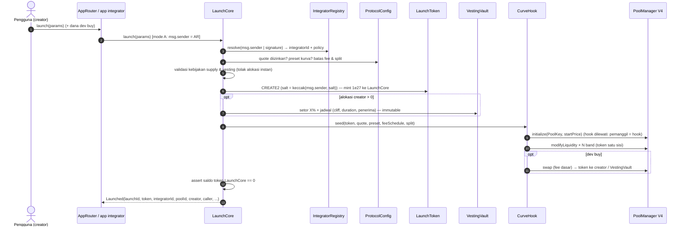
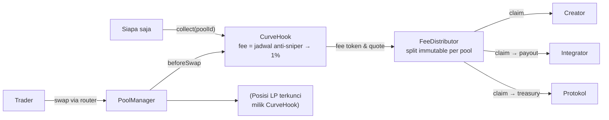

# 02 · Desain arsitektur: protokol peluncuran dua lapis di Elysium

Status: **draf untuk persetujuan**. Belum ada kode kontrak. Target pertama: **Elysium testnet (99801)**.
Nama kerja protokol: **ELP (Elysium Launch Protocol)**; nama final belum ditentukan.

Dasar riset: `01-riset-model-acuan.md` (Doppler, Bankr, Ascend dari sumber asli) dan
`../riset-launchpad-elysium.md` (launchpad yang sudah ada di Elysium).

---

## 1. Masalah yang diselesaikan

| Masalah di ekosistem sekarang | Bukti | Jawaban desain ini |
|---|---|---|
| Tidak ada protokol peluncuran bersama di Elysium; tiap launchpad vertikal (hook terikat ke launcher sendiri, tanpa field integrator, tanpa bagi hasil untuk app) | Kleos, BOXA, ElysPump, Eleos, Elyxa; Doppler tidak ada di 99901/99801 | Satu kontrak launch terbuka (lapis protokol) yang bisa dipakai banyak app |
| App front-end (Agora) tidak tercatat di chain dan tidak dapat apa pun | Agora memanggil launcher pihak lain langsung | Integrator tercatat di event dan dibayar otomatis dari fee swap |
| Label integrator bisa dipalsukan | Doppler: `integrator` diisi bebas (`Airlock.sol:182`), event tidak mencatatnya; 19 token "Bankr" palsu | Integrator = `msg.sender` terdaftar **atau** tanda tangan EIP-712 dari signer terdaftar; tidak ada field bebas |
| Alokasi dev instan | Doppler: vesting durasi 0 sah, sampai 80% supply (`DopplerERC20V1.sol:60,240,464`) | Kebijakan supply ditegakkan kontrak: 0% atau X% dengan cliff+vesting minimum; batas protokol; tanpa opsi instan |
| Referral/bagi hasil off-chain | Ascend: referral 20% dicatat off-chain; event `Launched` tanpa pemanggil | Porsi protokol/integrator/creator disimpan per pool, immutable, bisa dibaca siapa saja |

---

## 2. Gambaran dua lapis



Prinsip:
1. **Lapis protokol tidak tahu apa pun tentang app tertentu**; app kita hanya integrator #1 dengan hak yang sama seperti app lain.
2. **Semua yang memengaruhi uang pengguna dikunci saat launch** (snapshot), sehingga perubahan admin hanya berlaku untuk launch berikutnya.
3. **Tidak ada proxy/upgrade**; versi baru = deployment baru.

---

## 3. Lapis protokol: identitas integrator

### 3.1 Registry

`IntegratorRegistry` menyimpan satu record per integrator:

| Field | Diubah oleh | Catatan |
|---|---|---|
| `id` (uint32, berurutan) | — | Identitas kanonik. UI wajib menampilkan id + alamat, bukan nama |
| `account` | integrator (2 langkah) | Alamat yang boleh memanggil `launch` dalam mode A |
| `signer` | integrator | Kunci untuk mode B; EOA atau kontrak (EIP-1271) |
| `payout` | integrator | Penerima fee integrator; berlaku untuk klaim berikutnya |
| `name`, `uri` | integrator | Tidak unik, hanya label |
| `policy` | integrator, **tertunda 24 jam**, hanya untuk launch berikutnya | Lihat §4 dan §6 |
| `verified` | Timelock | Lencana tampilan; **tidak** diperlukan untuk launch |
| `active` | integrator / Timelock | Integrator nonaktif tidak bisa dipakai untuk launch baru; pool lama tetap membayar |

Pendaftaran permissionless (`register(...)`). Di mainnet bisa ditambah bond kecil yang bisa ditarik
kembali untuk mencegah spam (keputusan terbuka, lihat `03-rencana-kerja.md`).

**Pelajaran vanity address:** kecocokan dilakukan pada `id`/alamat penuh, bukan akhiran alamat atau nama.
Indexer dan UI mengambil label dari registry, bukan dari metadata token.

### 3.2 Tiga mode atribusi

| Mode | Siapa memanggil `launch` | Bukti identitas | `integratorId` |
|---|---|---|---|
| **A · Caller** | Kontrak/akun milik integrator (mis. `AppRouter`, modul CTO) | `msg.sender == registry.account(id)` dan `active` | id tersebut |
| **B · Signed** | Pengguna langsung (front-end tanpa kontrak, mis. Agora) | Tanda tangan EIP-712 `LaunchIntent` dari `registry.signer(id)` | id tersebut |
| **C · None** | Siapa saja | — | `0`; porsi integrator dialihkan ke protokol |

`LaunchIntent` (EIP-712, domain = `ELP`, `chainId`, `verifyingContract = LaunchCore`):

```
LaunchIntent {
  uint32  integratorId;
  address caller;        // harus == msg.sender: tanda tangan tidak bisa dipakai orang lain
  address creator;
  bytes32 paramsHash;    // hash LaunchParams tanpa tanda tangan
  uint256 nonce;         // sekali pakai per integrator
  uint64  deadline;
}
```

Tidak ada cara mengisi integrator lewat parameter bebas. Mode A dan B saling eksklusif dalam satu panggilan.

### 3.3 Event peluncuran

```
event Launched(
  uint256 indexed launchId,
  address indexed token,
  uint32  indexed integratorId,
  bytes32 poolId,
  address creator,
  address caller,            // msg.sender
  uint8   attribution,       // 0 none, 1 caller, 2 signed
  address quote,
  uint16  curvePresetId,
  FeeTerms feeTerms,         // jadwal fee + split, lihat §5–6
  SupplyTerms supplyTerms,   // pool, alokasi, vesting, dev buy
  uint16  coreVersion
);
```

Dengan event ini, siapa pun bisa menghitung ulang pembagian dan memastikan label app benar.

---

## 4. Kebijakan supply (ditegakkan kontrak)

Supply tetap **1.000.000.000** per token (konstanta protokol). Token di-mint **sekali** di konstruktor
ke `LaunchCore`, lalu dibagi habis dalam transaksi yang sama.

| Tujuan | Aturan | Batas protokol (konstanta) |
|---|---|---|
| **Pool** (likuiditas satu sisi) | `supply − alokasi` | ≥ 90% |
| **Alokasi creator** (opsional) | `0%` **atau** `X%` ke `VestingVault` | `X ≤ policy.maxAllocBps ≤ 1000` (10%) |
| Cliff | `cliff ≥ max(policy.minCliff, 30 hari)` | tidak boleh 0 bila X > 0 |
| Vesting | `duration ≥ max(policy.minDuration, 180 hari)`, `cliff < duration`, rilis linear setelah cliff | **tidak ada durasi 0** |
| Penerima alokasi | creator, maks 3 alamat, skema sama, **tidak bisa dialihkan** | dicatat di event |
| **Dev buy** (opsional) | Beli lewat pool di tx launch, membayar fee dasar (bukan fee anti-sniper) | `≤ policy.maxDevBuyBps ≤ 500` (5%) token keluar |
| Kunci dev buy (opsional per integrator) | Token hasil dev buy masuk `VestingVault` dengan kunci minimum | ditetapkan di policy |

Invarian yang diuji:
* Setelah `launch`, saldo token di `LaunchCore` = 0; `totalSupply = tokenDiPool + tokenDiVault` (dev buy keluar dari pool).
* `LaunchToken` tidak punya `owner`, `mint`, pajak transfer, blacklist, atau kunci transfer. Metadata immutable
  (syarat mirror bridge Elysium → HyperEVM).
* Tidak ada jalur lain untuk memindahkan token ke dev selain tiga tujuan di atas.

`policy` integrator hanya boleh **lebih ketat** daripada batas protokol. App kita (integrator #1) akan memakai
pilihan "0%" dan "5% dengan cliff 30 hari + vesting 1 tahun" (setara Bankr).

---

## 5. Mesin pool model Ascend

### 5.1 Keputusan: Uniswap V4, PoolManager di-deploy sendiri dari bytecode kanonik

| Pilihan | Untuk | Melawan |
|---|---|---|
| **Uniswap V4** (dipilih) | Tidak ada pause di core; owner hanya bisa menunjuk fee controller (≤ 0,1%); izin hook terkunci di alamat; tooling luas (aggregator, indexer, SDK); Uniswap sudah diumumkan untuk Elysium; artifact resmi tersedia di npm `@uniswap/v4-core@1.0.2` | BUSL-1.1 sampai 2027-06-15 untuk penggunaan produksi; alamat hook harus di-*mine* |
| PancakeSwap Infinity | GPL-2.0; model persis Ascend | Owner/pausable role bisa **membekukan swap semua pool**; fee protokol hingga 0,4%; tooling di Elysium hanya Ascend |

**Menumpang PoolManager pihak lain ditolak**:
* Fork V4 milik Kleos/BOXA tidak terverifikasi, dan owner-nya bisa memungut fee protokol dari pool kita.
* `CLPoolManager` Infinity milik Ascend di testnet bisa di-pause owner-nya, sehingga semua token kita ikut beku.

Jalur per jaringan:

| Jaringan | PoolManager |
|---|---|
| Testnet 99801 | Deploy sendiri dari artifact kanonik (penggunaan non-produksi diizinkan BUSL). Setelah deploy: `protocolFeeController = 0`, owner dipindah ke Timelock |
| Mainnet (nanti, butuh persetujuan terpisah) | (1) Pakai PoolManager resmi Uniswap bila sudah di-deploy di Elysium; atau (2) deploy sendiri setelah dapat *Additional Use Grant* / lewat 2027-06-15; atau (3) fallback Infinity yang di-deploy sendiri dengan pause role dicabut (hook perlu di-port) |

### 5.2 PoolKey dan izin hook

```
PoolKey {
  currency0/1 : token + quote (HYPE native = address(0), atau USDC)  // diurutkan
  fee         : DYNAMIC_FEE_FLAG
  tickSpacing : 200
  hooks       : CurveHook
}
```

| Izin hook | Fungsi |
|---|---|
| `beforeInitialize` | Tolak pool dengan hook kita yang tidak dibuat oleh `CurveHook` sendiri |
| `beforeAddLiquidity` | Tolak semua penambahan likuiditas dari luar: pool tertutup |
| `beforeSwap` | Kembalikan fee jadwal (anti-sniper → fee dasar) dengan `OVERRIDE_FEE_FLAG` |

V4 tidak memanggil hook bila pemanggilnya hook itu sendiri, sehingga `initialize`, penanaman likuiditas, dan
`collect` oleh `CurveHook` lolos. Fase 1 tidak butuh `*ReturnsDelta`. Alamat `CurveHook` di-*mine* via CREATE2
agar bit izinnya tepat.

Akibat yang sama berlaku untuk dev buy: swap oleh `CurveHook` melewati `beforeSwap` dan memakai fee LP dinamis
yang **tersimpan** di pool (awalnya 0). Karena itu urutan di `seed` adalah `initialize` → tanam band →
`updateDynamicLPFee(baseFee)` → dev buy. Dev buy membayar fee dasar, bukan fee anti-sniper. Nilai tersimpan ini
juga yang dibaca aggregator saat menghitung kuotasi.

### 5.3 Kurva bertingkat (likuiditas satu sisi)

* **Preset kurva** didaftarkan di `ProtocolConfig` per quote: `startTick` dan daftar band `{offsetLower, offsetUpper, bps}`.
* Validasi preset: band terurut dan tidak tumpang tindih, kelipatan `tickSpacing`, total `bps = 10.000`, dalam
  rentang tick yang sah, likuiditas per tick di bawah batas PoolManager.
* Integrator memilih preset dari daftar yang diizinkan; creator tidak bisa mengirim kurva bebas. Ini mencegah kurva
  jebakan seperti band pertama yang sangat tipis.
* Preset awal mengikuti pola Ascend: harga dinaikkan bertahap dengan beberapa band besar dan band transisi kecil.
  Angka konkretnya ditetapkan di fase 3 dengan simulasi.

### 5.4 Fee anti-sniper lalu flat

```
fee(t) = baseFee + (startFee − baseFee) · (decay − t) / decay   untuk 0 ≤ t < decay
fee(t) = baseFee                                                untuk t ≥ decay
t = block.timestamp − launchedAt
```

| Parameter | Batas protokol | Usulan default |
|---|---|---|
| `startFee` | ≤ 90% | 90% |
| `decay` | 0–60 detik | 10 detik |
| `baseFee` | 0,3%–2% | 1% |

* Jadwal disimpan per pool saat launch dan **immutable**.
* Catatan Elysium: blok 100 ms tetapi `block.timestamp` beresolusi 1 detik, jadi penurunan fee berlangsung per detik.
* `block.number` tidak dipakai, karena di Orbit nilainya adalah nomor blok parent chain.

### 5.5 LP terkunci

* Semua posisi dimiliki `CurveHook` (salt 0). **Tidak ada fungsi yang memanggil `modifyLiquidity` dengan delta negatif.**
* `collect(poolId)` permissionless memanen fee dengan `modifyLiquidity(…, 0)`, lalu meneruskannya ke `FeeDistributor`.
* Invarian: likuiditas setiap band tidak pernah turun (diuji dengan fuzz/invariant).

### 5.6 Fase 2 (di luar cakupan awal)

* Flywheel bid ala Ascend: cadangan beli dengan batas EMA dan clip per jendela waktu.
* Fee hanya dalam quote (lewat `beforeSwapReturnsDelta`).
* Listing HyperCore setelah `ElysiumCoreWriter` tersedia.

---

## 6. Bagi hasil fee (on-chain, bisa diaudit)

Fee LP terkumpul di posisi milik `CurveHook` dalam dua mata uang (token dan quote), lalu dipanen dengan
`collect`. `FeeDistributor` membaginya dengan porsi yang **di-snapshot saat launch**:

| Porsi | Asal nilai | Batas | Usulan default |
|---|---|---|---|
| `protocolBps` | `ProtocolConfig` saat launch | 1000–3000 | 2000 (20%) |
| `integratorBps` | `policy` integrator | 0–3000 | 3000 (30%) untuk app kita |
| `creatorBps` | sisa | ≥ 4000 | 5000 (50%) |

* Mode C (tanpa integrator): `integratorBps` dialihkan ke protokol, dan ini tercatat di event.
* Akuntansi: `owed[poolId][role][currency]`. Klaim:
  * creator: alamat peran creator saat ini (bisa dialihkan 2 langkah oleh creator; admin tidak bisa menimpa);
  * integrator: `payout` di registry saat klaim;
  * protokol: treasury di `ProtocolConfig`.
* Pembagian per klaim tercatat di event `FeesSplit(poolId, amount0, amount1, toProtocol, toIntegrator, toCreator)`.
  Getter `feeTerms(poolId)` mengembalikan porsi yang berlaku.
* Pembulatan: sisa wei masuk ke creator agar total selalu tepat (diuji).

Perbandingan: Bankr membayar creator ±38% dari total fee 1,75%; Ascend 50% creator / 50% protokol dengan referral
di luar chain; Doppler mengambil ±5%. Usulan 50/30/20 memberi insentif nyata bagi app tanpa mengurangi creator di
bawah Ascend.

---

## 7. Lapis app

### 7.1 App kita (integrator #1)

* **`AppRouter`**: kontrak tipis, terdaftar sebagai `account` integrator #1. Fungsi:
  `launch(params)` (meneruskan ke `LaunchCore` dengan `creator = msg.sender`, menarik dana dev buy dari pengguna)
  dan helper swap (beli/jual lewat PoolManager).
* Tanpa state uang, tanpa *arbitrary call*, tanpa owner yang bisa memindahkan dana pengguna.
* Frontend statis (menggantikan frontend MVP), indexer berbasis event `Launched` / `FeesSplit` / `Swap`.

### 7.2 Integrator pihak ketiga (mis. Agora)

Langkah onboarding:
1. `IntegratorRegistry.register(name, uri, account, signer, payout, policy)`.
2. Pilih mode:
   * **A**: deploy router sendiri; pengguna memanggil router.
   * **B**: backend menandatangani `LaunchIntent`; pengguna memanggil `LaunchCore` langsung.
3. Policy berlaku untuk launch yang dibuat setelah jeda 24 jam.
4. Klaim fee kapan saja ke `payout`.

Kami menyediakan SDK TypeScript kecil untuk membangun `LaunchParams` dan `LaunchIntent`, plus contoh integrasi.

---

## 8. Alur launch



Alur swap dan fee:



---

## 9. Daftar kontrak dan tanggung jawab

| # | Kontrak | Lapis | Tanggung jawab | Admin |
|---|---|---|---|---|
| 1 | `LaunchCore` | Protokol | Gerbang `launch`; resolusi integrator; validasi policy, preset, fee; deploy token; orkestrasi vault + hook; emit `Launched`; pause launch baru | Timelock (pause: guardian) |
| 2 | `IntegratorRegistry` | Protokol | Daftar integrator, signer, payout, policy tertunda, nonce EIP-712, flag `verified` | Integrator untuk record-nya; Timelock hanya `verified`/`active` |
| 3 | `ProtocolConfig` | Protokol | Quote yang diizinkan, preset kurva, batas & default fee, `protocolBps`, treasury | Timelock; perubahan hanya untuk launch berikutnya |
| 4 | `LaunchToken` | Protokol | ERC-20 polos, supply tetap, metadata immutable, tanpa owner | Tidak ada |
| 5 | `VestingVault` | Protokol | Simpan alokasi; cliff + linear; `release` oleh siapa saja ke penerima tetap | Tidak ada |
| 6 | `CurveHook` | Protokol | Hook V4; buat pool, tanam band, jadwal fee, blok likuiditas luar, `collect`; pemilik posisi LP | Tidak ada (hanya `LaunchCore` yang boleh `seed`) |
| 7 | `FeeDistributor` | Protokol | Akuntansi `owed` per pool/peran; klaim; pengalihan peran creator | Tidak ada |
| 8 | `TimelockController` + Safe | Tata kelola | Pemilik admin; jeda wajib | Multisig |
| 9 | `PoolManager` (V4 kanonik) | Infrastruktur | AMM singleton | Owner → Timelock, fee controller = 0 |
| 10 | Router swap + `V4Quoter` | Infrastruktur | Swap & kuotasi (periphery resmi atau router minimal) | Tidak ada |
| 11 | `AppRouter` | App | Integrator #1: launch atas nama pengguna, helper swap | Tidak ada |
| 12 | Frontend, indexer, SDK | App | UI, data, integrasi pihak ketiga | — |

Kontrak MVP lama (`contracts/ElysiumLaunchpad.sol`, bonding curve → Uniswap V2) dipensiunkan dan disimpan sebagai referensi.

---

## 10. Keamanan dan tata kelola

### 10.1 Peran

| Peran | Pemegang | Bisa | Tidak bisa |
|---|---|---|---|
| Owner protokol | `TimelockController` (proposer: Safe multisig; jeda testnet 1 jam, mainnet 48 jam) | Ubah `ProtocolConfig` dalam batas konstanta; set `verified`/`active` integrator; unpause | Menyentuh pool, fee yang sudah terkumpul, vesting, atau token yang sudah diluncurkan |
| Guardian | Safe multisig (tanpa jeda) | **Pause** `launch` dan pendaftaran integrator baru | Pause swap, `collect`, klaim, rilis vesting; unpause (harus lewat Timelock) |
| Integrator | Pemilik record | Ubah signer/payout (langsung), policy (tertunda 24 jam, hanya launch baru) | Mengubah pool yang sudah ada |
| Creator | Alamat peran creator | Klaim; alihkan peran (2 langkah) | Mengubah split, fee, kurva, vesting |

### 10.2 Yang tidak boleh bisa diubah setelah launch

Supply token; metadata token; PoolKey (termasuk hook dan quote); preset kurva dan posisi LP; jadwal fee
(start, decay, base); split protokol/integrator/creator; `integratorId` pool; alokasi, penerima, dan jadwal vesting;
status LP terkunci.

### 10.3 Batas parameter (konstanta kode, bukan setelan)

`TOTAL_SUPPLY = 1e27` · `MAX_ALLOC_BPS = 1000` · `MIN_CLIFF = 30 hari` · `MIN_VESTING = 180 hari` ·
`MAX_DEVBUY_BPS = 500` · `MAX_START_FEE = 90%` · `MAX_DECAY = 60 s` · `BASE_FEE ∈ [0,3%, 2%]` ·
`PROTOCOL_BPS ∈ [1000, 3000]` · `MAX_INTEGRATOR_BPS = 3000` · `MIN_CREATOR_BPS = 4000` · `TICK_SPACING = 200` ·
`POLICY_DELAY = 24 jam`.

### 10.4 Pengaman lain

* Tanpa proxy, tanpa `delegatecall` ke alamat dinamis, tanpa *arbitrary call*.
* Reentrancy guard transien (ArbOS di Elysium mendukung `TSTORE`).
* Quote hanya token standar dari whitelist; tidak mendukung token fee-on-transfer atau rebasing.
* Alamat token: `CREATE2` dengan salt `keccak(msg.sender, salt)`, supaya salt tidak bisa didahului orang lain.
* EIP-712 memakai domain `chainId` + `verifyingContract`, nonce sekali pakai, `deadline`, pengikatan `caller`,
  dan dukungan EIP-1271.
* Invarian yang diuji: konservasi supply, LP tidak pernah berkurang, total klaim ≤ total fee, porsi tidak berubah
  setelah launch, tidak ada token tersisa di `LaunchCore`.
* Audit eksternal wajib sebelum mainnet.

### 10.5 Risiko yang tetap ada

| Risiko | Mitigasi |
|---|---|
| Owner PoolManager (bila nanti menumpang PoolManager resmi Uniswap) mengaktifkan fee protokol ≤ 0,1% | Diterima dan didokumentasikan; tidak ada pause |
| Lisensi BUSL v4-core untuk produksi | Mainnet butuh keputusan terpisah (§5.1) |
| Spam pendaftaran integrator / nama tiruan | Nama tidak unik, `verified` via Timelock, UI menampilkan id; opsi bond |
| Sniper dalam detik pertama | Fee 90% yang menurun; dev buy dibatasi dan tercatat |
| Kunci signer integrator bocor | Integrator bisa rotasi signer; nonce & `deadline`; dampak terbatas pada atribusi launch baru |
| Granularitas `block.timestamp` 1 detik | Decay dihitung per detik; minimal 0 s (tanpa decay) atau ≥ beberapa detik |
